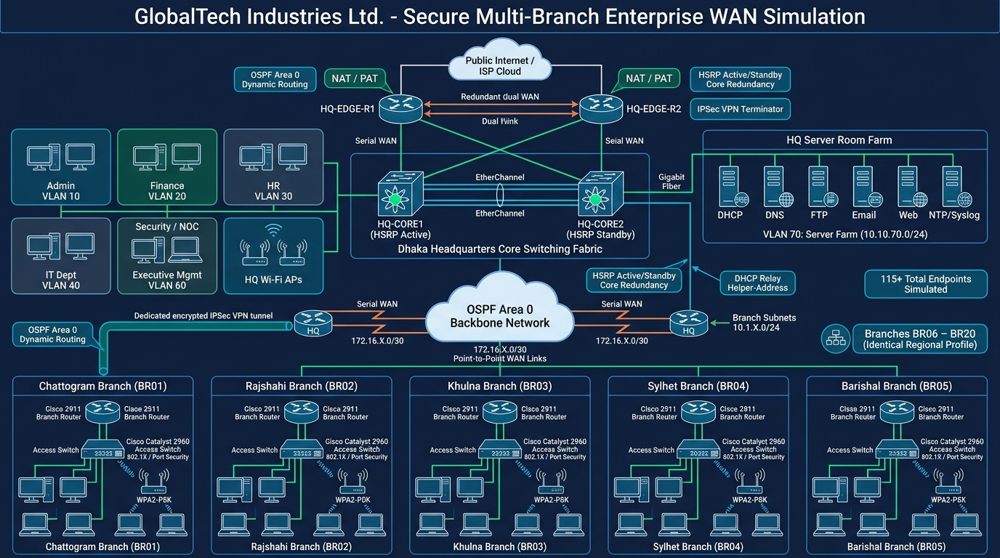

# GlobalTech Industries Ltd. — Secure Multi-Branch Enterprise Network WAN Simulation
## Cisco Packet Tracer Project | BUP ICE 2208 Computer Network Laboratory



### 📌 Project Title
**Secure Multi-Branch Enterprise Network WAN Simulation for GlobalTech Industries Ltd.**

### 👥 Project Team
| Member | ID | Section | Role |
|:---|:---|:---:|:---|
| **Partho Sarothi Ghosh** | 24549010089 | B | HQ Architecture: Core Switches (HSRP), Edge Routers, NAT/PAT, Server Farm |
| **Aritry Talukdar** | 24549010069 | B | Branch/WAN Architecture: 20 Branch Configurations, OSPF, DHCP Relay, ACLs, Port Security |

### 🎓 Academic Supervision
* **Course**: ICE 2208 — Computer Network Laboratory
* **Supervisor**: **Sharmeen Jahan Seema**, Lecturer, Department of Information and Communication Technology (ICT), Faculty of Science and Technology (FST), Bangladesh University of Professionals (BUP).

---

### 📊 Network Scale & Statistics
| Component | Quantity | Description / Roles |
|:---|:---:|:---|
| **Regional Branches** | 20 | Chattogram, Rajshahi, Khulna, Sylhet, Barishal, Rangpur, Mymensingh, Comilla, Gazipur, Narayanganj, Bogra, Coxs Bazar, Jessore, Dinajpur, Tangail, Brahmanbaria, Narsingdi, Savar, Tongi, Faridpur |
| **HQ Core Switches** | 2 | Cisco 3560/3650 Layer-3 Switches (HSRP Active/Standby, Inter-VLAN Routing) |
| **HQ Edge Routers** | 2 | Primary (NAT/PAT, IPSec) & Secondary (Redundant OSPF WAN aggregation) |
| **Branch Routers** | 20 | Cisco 2911 / 2600 Routers (DHCP Relay, OSPF Area 0, ACLs) |
| **HQ Access Switches** | 2 | Cisco 2960 Layer-2 Switches (Departmental VLANs, Port Security) |
| **Branch Access Switches** | 20 | Cisco 2960 Layer-2 Switches (Port Security Sticky MAC, Unused Ports Shutdown) |
| **HQ Central Servers** | 6 | Dedicated servers: DHCP, DNS, FTP, Email (SMTP/POP3), Web (HTTP), NTP/Syslog |
| **Wired Endpoints** | 115 | 15 HQ Department PCs + 100 Branch PCs (5 per branch) |
| **Wireless Access Points** | 22 | 2 HQ APs (WPA2-PSK) + 20 Branch APs |
| **Total Simulated Devices** | **190+** | Enterprise multi-tier network deployment |

---

### 🚀 Key Network Protocols & Features
* **Dynamic Routing**: Single-Area OSPF (Process ID 10, Area 0) with automatic path re-convergence and cost optimization.
* **Gateway Redundancy**: HSRP (Hot Standby Router Protocol) on HQ Layer-3 core switches (`HQ-CORE1` Active Priority 110, `HQ-CORE2` Standby Priority 90).
* **Network Segmentation**: 9 Departmental VLANs (Admin, Finance, HR, IT, NOC, Mgmt, Servers, Guest, Wireless).
* **Centralized Services**:
  * **DHCP**: Central server (`10.10.70.10`) serving 20 distinct branch pools via `ip helper-address` relays.
  * **DNS**: Full internal domain name resolution (`globaltech.local`).
  * **File Server**: Authenticated FTP server (`files.globaltech.local`) with user privilege tiers.
  * **Mail**: SMTP/POP3 internal email server (`mail.globaltech.local`).
  * **Web**: Intranet enterprise portal (`www.globaltech.local`).
  * **NTP/Syslog**: Centralized time synchronization and audit log archiving.
* **Network Security**:
  * **Port Security**: Static/Sticky MAC binding with violation shutdown/restrict.
  * **Extended Access Control Lists (ACLs)**: Isolation of network management VLAN 60 and guest isolation.
  * **Secure Administration**: SSHv2 enabled with 2048-bit RSA keys; Telnet administratively disabled.
  * **Edge Security**: NAT/PAT overload on `HQ-EDGE-R1` and site-to-site IPSec VPN simulation.

---

### 📂 Repository Structure
```
Computer-Network-Project/
├── Main Project/
│   ├── CN poject main.pkt                  # Primary Cisco Packet Tracer project
│   └── 493757.png                          # Bangladesh geographical district map overlay
├── Resorce/
│   ├── configs/
│   │   ├── HQ/                             # HQ Core 1/2, Edge 1/2, Access Switch configs & server setup
│   │   ├── Branches/                       # Ready-to-paste configurations for BR01 to BR20
│   │   ├── WAN/                            # WAN topology architecture and link distribution
│   │   └── Wireless/                       # Wireless AP SSID, channels & security setup
│   ├── docs/
│   │   ├── IP_ADDRESSING_TABLE.txt         # Complete VLSM addressing matrix
│   │   ├── CABLING_AND_PORT_CONNECTION_MAP.txt # Physical port-by-port cable map
│   │   ├── SECURITY_POLICY.txt             # Multi-layer enterprise security policy
│   │   ├── GlobalTech_Multibranch_Cisco_Project_Master_Plan.txt # Master technical plan
│   │   └── Project_Proposal_GlobalTech_BUP.docx # Formal academic proposal document
│   ├── diagrams/                           # Network topology SVGs, PNGs and interactive HTML viewer
│   ├── reference_pkts/                     # 9 Standalone verification Packet Tracer models
│   ├── ALL_DEVICES_COPY_PASTE_MASTER.txt   # Master unified CLI script for all devices
│   └── GlobalTech_Whole_Project_Demo_Picture.jpg
└── README.md
```

---

### 🛠️ How to Open and Run the Project
1. Open **Cisco Packet Tracer** (version 8.x or 9.0+).
2. Open `Main Project/CN poject main.pkt`.
3. To inspect device configurations, refer to `Resorce/ALL_DEVICES_COPY_PASTE_MASTER.txt`.
4. For interactive diagram inspection, open `Resorce/diagrams/Network_Topology_Viewer.html` in any web browser.
